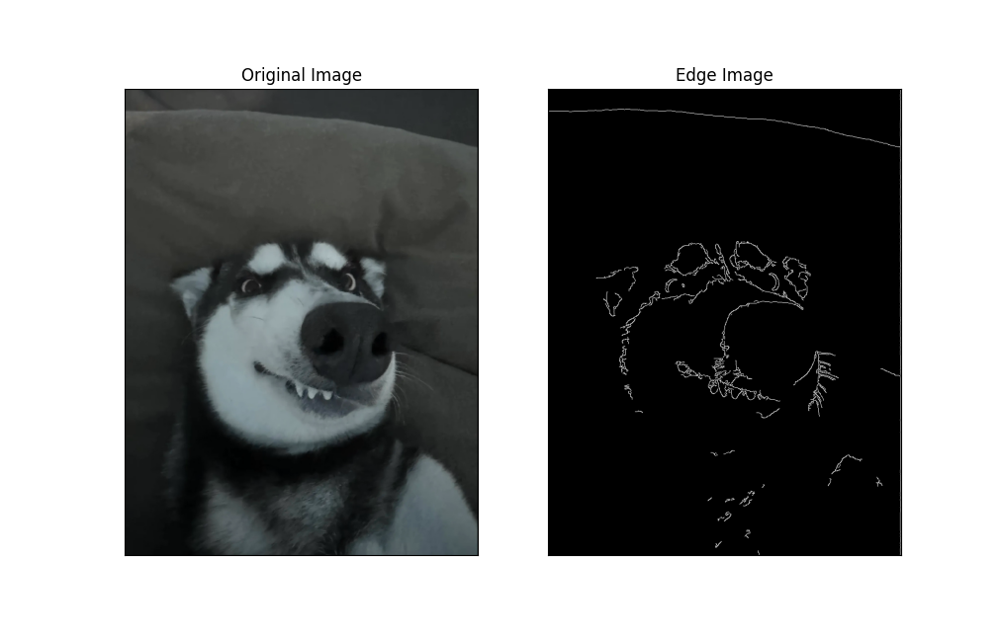
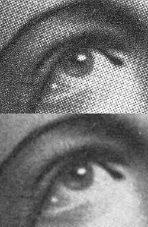
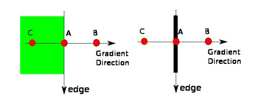
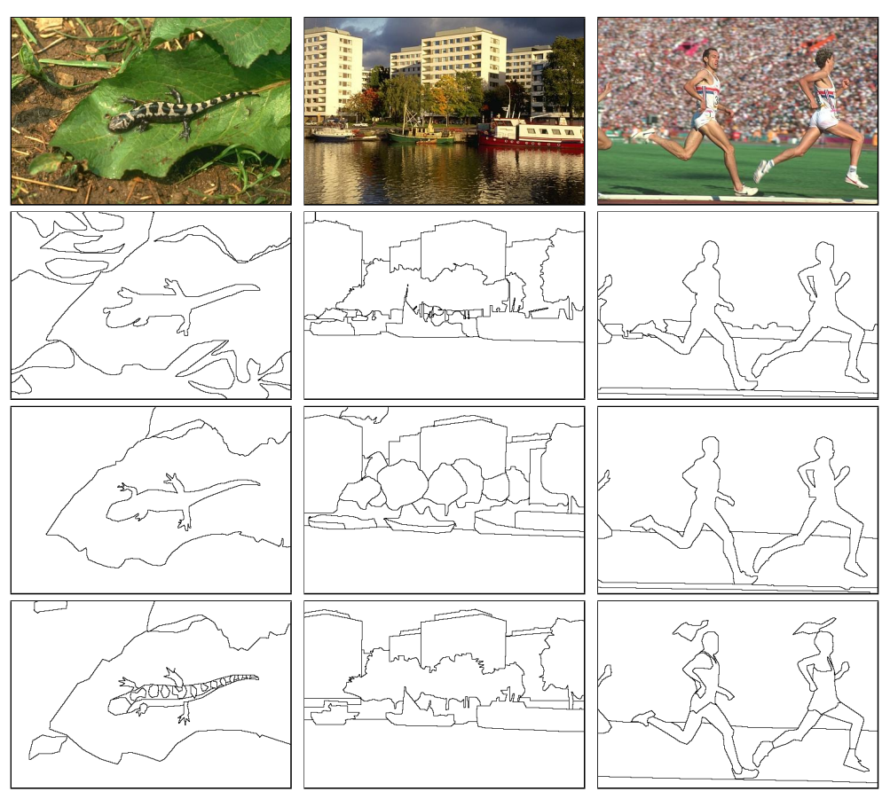
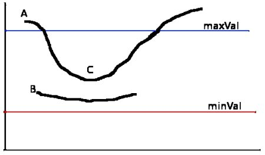

Đây là **đoạn mở đầu** của bài viết. Nó có *chữ nghiêng*, ~~gạch ngang~~, một [liên kết](https://github.com/luannt0801) và `inline_code()` nằm giữa câu. Mục tiêu: mọi block bên dưới phải hiện **đúng thứ tự** đã viết.

## 1. Ảnh giữa các đoạn văn

Đoạn văn ngay trước ảnh mặc định (căn giữa, có caption).



Đoạn văn ngay sau ảnh. Tiếp theo là một ảnh gốc rất lớn: nó phải tự co lại vừa cột chữ.



{: .inline}

Ảnh `.inline` nổi sang phải trên màn hình rộng và trở về một cột trên mobile. Đoạn văn này đủ dài để chữ chảy quanh ảnh: Lorem ipsum dolor sit amet, consectetur adipiscing elit, sed do eiusmod tempor incididunt ut labore et dolore magna aliqua. Ut enim ad minim veniam, quis nostrud exercitation ullamco laboris nisi ut aliquip ex ea commodo consequat.

{: .small}

### 1.1 Ảnh trong danh sách

1. Bước một: đọc ảnh.
2. Bước hai: làm mờ, ảnh nằm bên trong list item:

   

3. Bước ba: tìm cạnh.

## 2. Code nhiều ngôn ngữ

Code Python có tiêu đề file và số dòng:

```python
import torch
from torch import nn


class MLP(nn.Module):
    """Two-layer perceptron."""

    def __init__(self, d_in: int, d_hidden: int = 128) -> None:
        super().__init__()
        self.net = nn.Sequential(nn.Linear(d_in, d_hidden), nn.ReLU(), nn.Linear(d_hidden, 1))

    def forward(self, x):
        return self.net(x)  # shape: (batch, 1)
```
{: .line-numbers data-title="model.py"}

Một dòng rất dài phải cuộn ngang trong khung, không làm vỡ trang (thử nút wrap):

```bash
docker run --gpus all -p 8000:8000 -v ~/.cache/huggingface:/root/.cache/huggingface vllm/vllm-openai:latest --model Qwen/Qwen2.5-7B-Instruct --max-model-len 8192 --gpu-memory-utilization 0.9
```

```javascript
const sum = (xs) => xs.reduce((a, b) => a + b, 0);
console.log(`total = ${sum([1, 2, 3])}`);
```

```typescript
interface Post { title: string; tags: string[] }
export function isTagged(p: Post, tag: string): boolean {
  return p.tags.includes(tag);
}
```

```cpp
#include <vector>
int main() {
    std::vector<int> v{1, 2, 3};
	for (auto x : v) { /* tab-indented line */ }
    return 0;
}
```

```java
public class Hello {
    public static void main(String[] args) { System.out.println("Hello"); }
}
```

```sql
SELECT category, COUNT(*) AS n
FROM posts
WHERE published = TRUE
GROUP BY category
ORDER BY n DESC;
```

```json
{ "model": "vllm", "max_tokens": 512, "stream": true }
```

```yaml
layout: post
categories:
  - AI & ML
```

```html
<figure class="wide"><figcaption>Caption</figcaption></figure>
```

```css
.prose figure.wide { width: min(920px, 100vw - 32px); }
```

```latex
\begin{equation}
  \mathcal{L} = -\sum_i y_i \log \hat{y}_i
\end{equation}
```

## 3. Trích dẫn, danh sách, bảng

> Simplicity is prerequisite for reliability.
>
> — Edsger W. Dijkstra

- Gạch đầu dòng một
- Gạch đầu dòng hai
  - Mục con với `code`
- Gạch đầu dòng ba

| Ngôn ngữ | Highlight | Ghi chú |
|---|---|---|
| Python | ✔ | Có số dòng |
| Bash | ✔ | Dòng dài cuộn ngang |
| LaTeX | ✔ | Công thức |

---

## 4. Công thức và nhúng

Công thức inline $E = mc^2$ và công thức khối:

$$
\nabla_\theta J(\theta) = \mathbb{E}\left[\nabla_\theta \log \pi_\theta(a \mid s)\, Q(s, a)\right]
$$



## Kết luận

Nếu mọi thứ phía trên hiển thị đúng thứ tự, đúng layout trên desktop và mobile, phần render đã sẵn sàng.
