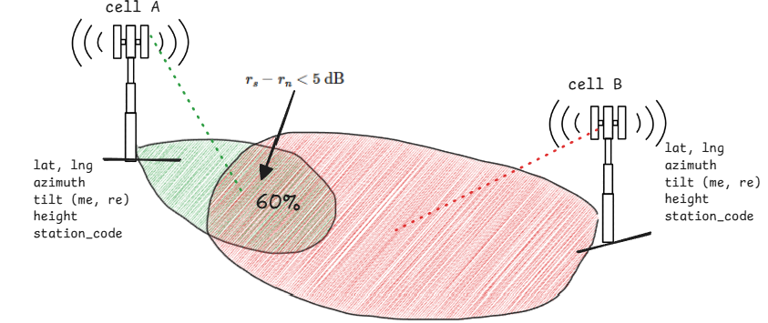

Viettel vừa trở thành nhà mạng đầu tiên tại Việt Nam đạt cấp độ tự trị cao nhất thế giới tính đến hiện nay, là nhà mạng đầu tiên tại Đông Nam Á chinh phục chứng chỉ ANL4 *(Nguồn: [Báo Viettel Family](https://vtnet.viettelfamily.com/news/vtnet-dat-chung-nhan-mang-tu-tri-cap-do-cao-nhat-the-gioi-hien-nay-tu-tm-forum))*. Mạng tự trị cấp độ 4 (Autonomous Networks Level 4 – ANL4) hướng tới khả năng vận hành mạng gần như hoàn toàn tự động. Hệ thống có thể chủ động giám sát, phát hiện vấn đề, phân tích nguyên nhân, đưa ra quyết định và thực thi các hành động điều chỉnh, tối ưu chất lượng mạng mà không cần sự can thiệp trực tiếp của con người. Điều này đòi hỏi các thuật toán, mô hình AI đưa ra có khả năng chính xác cao, xử lý với dữ liệu lớn của toàn mạng lưới với hàng triệu thuê bao.

Tôi cảm thấy khá vui và có chút thành tựu khi là người nghiên cứu và phát triển chính các thuật toán, mô hình AI giải quyết các bài toán trong tự động hóa mạng lưới.

## Bài toán tối ưu chất lượng mạng
Dự án mà tôi tham gia ngay từ những ngày đầu vào làm việc tại team X là dự án _“Tối ưu chất lượng mạng truy nhập vô tuyến - RAN Network Quality Optimization”_.

Bài toán đặt ra mục tiêu là điều chỉnh các tham số của các thiết bị phát trong trong mạng sao cho đảm bảo vùng phủ không bị chồng lấn hoặc gây ra vùng phủ lõm và tối đa được thông lượng mạng.

- **Vùng lõm sóng**: Là vùng tín hiệu yếu, người dùng sẽ mất sóng tín hiệu 4G/5G. Giống như khi bạn đi vào thang máy thì tín hiệu sóng vô tuyến sẽ mất vậy
- **Vùng chồng lấn**: Vùng tín hiệu nhiễu, bởi 2 thiết bị phát sóng chung băng tần đè lên nhau. Tín hiệu của người dùng trong khu vực này sẽ không đạt được băng thông cao. (xem video bằng 4G/5G bị lag chẳng hạn)
- **Thông lượng mạng**: Chính là băng thông 4G/5G đơn vị là Mbps/s.

Ngoài ra còn 1 số bài toán về vận hành khi đảm bảo về tài nguyên vô tuyến (PRB, load, mobility, Hand-over, ...) mà tôi đã nghiên cứu và thực hiện nhưng tôi sẽ ko để cập.

**Ví dụ:** thành phố Hà Nội là đô thị đông dân cư với địa hình nhiều tòa nhà cao tầng cũng như nhiều nhà ống tầm thấp san sát nhau cùng với đó là mật độ người dùng 4G/5G - chính là chiếc điện thoại của chúng ta rất lớn.

Các vật cản trong không gian (tòa nhà, cây cối, đặc tính địa hình nhiều thiết bị phát sóng, ...) đều ảnh hưởng đến chất lượng và phạm vi vùng phủ của từng thiết bị phát sóng.

Đây là điều mà ta không nắm được, chỉ có thể phân tích từ các pattern của dữ liệu nhằm dự đoán, phân tích.

**Điều khó khăn nhất** là khi 1 trạm phát sóng có vùng phủ yếu/quá rộng, nếu ta điều chỉnh tham số cấu hình để mở rộng vùng phủ/thu hẹp vùng phủ thì có thể gây ra chồng lấn lên các trạm lân cận/gây ra lõm sóng.

- Mở rộng vùng phủ trạm $\rightarrow$ gây chồng lấn trạm lân cận
- Thu hẹp vùng phủ trạm $\rightarrow$ gây ra vùng lõm sóng.

Việc tối ưu 1 khu vực tỉnh thành với cả trăm trạm phát sóng san sát và đồng thời tìm ra 1 bộ tham số tối ưu cho hàng trăm trạm trong khu vực để đạt tới trạng thái tối ưu nhất: Ít lõm nhất, ít chồng lấn nhất, tối đa dung lượng mạng của mỗi người dùng trong khu vực khiến cho bài toán trở thành 1 bài tối ưu NP-hard.

Đây là overview để ta có góc nhìn về độ phức tạp của bài toán. 😂😂

