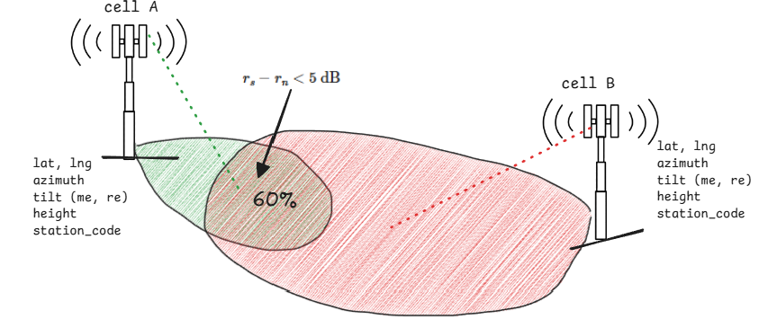

Viettel vừa trở thành nhà mạng đầu tiên tại Việt Nam đạt cấp độ tự trị cao nhất thế giới tính đến hiện nay, là nhà mạng đầu tiên tại Đông Nam Á chinh phục chứng chỉ ANL4.

_Các nguồn báo đăng tin:_
- [Báo Viettel Family](https://vtnet.viettelfamily.com/news/vtnet-dat-chung-nhan-mang-tu-tri-cap-do-cao-nhat-the-gioi-hien-nay-tu-tm-forum)*.
- [Báo chính phủ - Viettel đạt chuẩn mạng tự trị cao nhất thế giới](https://baochinhphu.vn/viettel-dat-chuan-mang-tu-tri-cao-nhat-the-gioi-102261119230239182.htm)
- [Báo nhân dân - Viettel đạt chứng nhận mạng tự trị cấp độ 4 ở hai nghiệp vụ trọng điểm](https://nhandan.vn/viettel-dat-chung-nhan-mang-tu-tri-cap-do-4-o-hai-nghiep-vu-trong-diem-post1003982.html)
- [Báo Vietnam (english) - Viettel achieves the highest autonomous network standard in the world.](https://www.vietnam.vn/en/viettel-dat-chuan-mang-tu-tri-cao-nhat-the-gioi)

_Và video phóng sự trên đài truyền hình quốc gia  VTV1 đăng tin tại:_
- [Phóng sự VTV1 - Mạng tự trị](https://youtu.be/7XookLck0QA)

Mạng tự trị cấp độ 4 (Autonomous Networks Level 4 – ANL4) hướng tới khả năng vận hành mạng gần như hoàn toàn tự động, là một bước tiến lớn trong việc tự động hóa mạng viễn thông.

Hãy tưởng tượng thay vì phải có kỹ sư liên tục theo dõi hàng nghìn trạm phát sóng, phát hiện sự cố rồi điều chỉnh cấu hình thủ công, hệ thống có thể tự làm gần như toàn bộ những công việc đó. Nó có thể tự giám sát chất lượng mạng, phát hiện những khu vực có vấn đề, phân tích nguyên nhân, tìm phương án khắc phục và chủ động điều chỉnh hệ thống để cải thiện chất lượng dịch vụ.

Để làm được điều đó, phía sau hệ thống cần có những thuật toán và mô hình AI đủ thông minh, chính xác và có khả năng xử lý lượng dữ liệu khổng lồ từ hàng triệu thuê bao và dữ liệu giám sát khổng lồ trên toàn mạng lưới.

Tôi cảm thấy khá vui và có chút thành tựu khi là người nghiên cứu và phát triển chính các thuật toán, mô hình AI giải quyết các bài toán trong tự động hóa mạng lưới.

## Tổng quan về bài toán _“Tối ưu chất lượng mạng truy nhập vô tuyến - RAN Network Quality Optimization”_.

Để dễ hình dung, hãy thử tưởng tượng bạn đang sử dụng điện thoại để xem YouTube, gọi video hoặc lướt Facebook bằng mạng 4G/5G. Chất lượng mạng mà bạn trải nghiệm phụ thuộc rất nhiều vào các trạm phát sóng xung quanh. Mỗi trạm phát sóng giống như một chiếc đèn chiếu sáng, chỉ khác là thay vì phát ra ánh sáng, nó phát ra sóng vô tuyến để điện thoại của chúng ta có thể kết nối Internet.

Vấn đề là không phải cứ phát sóng mạnh hơn thì mạng sẽ tốt hơn!

Nếu các trạm phát sóng được cấu hình không hợp lý, chúng có thể gây ra những vấn đề như:

- **Vùng lõm sóng**: Đây là những khu vực mà tín hiệu từ các trạm phát sóng quá yếu, khiến điện thoại khó kết nối Internet, mạng chập chờn hoặc thậm chí mất sóng.
  _Ví dụ: Bạn đang đi trên đường, sử dụng điện thoại bình thường nhưng khi đi vào một khu vực nào đó thì mạng đột nhiên rất yếu, không thể tải được video hoặc thực hiện cuộc gọi ổn định.
- **Vùng chồng lấn**: Đây là khu vực có nhiều trạm phát sóng cùng phủ tới, nhưng tín hiệu từ các trạm lại gây ảnh hưởng lẫn nhau. Hãy tưởng tượng trong một căn phòng có nhiều người cùng nói chuyện thật to. Bạn vẫn nghe được âm thanh, nhưng rất khó tập trung vào một người cụ thể. Trong mạng di động cũng có tình huống tương tự. Điện thoại có thể nhận được tín hiệu từ nhiều trạm phát sóng, nhưng sự can nhiễu khiến chất lượng kết nối giảm xuống.
- **Dung lượng và tốc độ mạng (Network Throughput):** Đây là lượng dữ liệu mà mạng có thể truyền tải trong một khoảng thời gian nhất định, thường được đo bằng Mbps. Nói đơn giản, đây chính là tốc độ tải dữ liệu mà chúng ta cảm nhận khi sử dụng điện thoại.

Mục tiêu của bài toán là làm sao để người dùng có thể sử dụng mạng nhanh và ổn định nhất, đồng thời hạn chế tối đa vùng mất sóng và vùng bị ảnh hưởng bởi các trạm lân cận. 

## Tại sao đây là một bài toán khó?

Hãy lấy Hà Nội làm ví dụ.



Đây là một đô thị có mật độ dân cư rất lớn, với đủ loại địa hình và công trình xây dựng: những tòa nhà cao tầng, các khu chung cư, nhà ống san sát nhau, cây cối và nhiều vật cản khác.

Trong khi đó, hàng triệu người cùng sử dụng điện thoại và kết nối vào mạng di động mỗi ngày.

Mỗi vật cản, mỗi tòa nhà, khoảng cách giữa các trạm phát sóng và thậm chí cả vị trí người dùng đều có thể ảnh hưởng đến khả năng truyền sóng.

Vì vậy, dù biết vị trí các trạm phát sóng, chúng ta cũng không thể đơn giản nhìn vào bản đồ để biết chính xác chất lượng sóng tại mọi vị trí. Phải kết hợp dữ liệu thực tế và các mô hình phân tích để ước lượng, đánh giá và dự đoán.

**Điều khó nhất nằm ở chỗ: Mỗi lần điều chỉnh một trạm phát sóng đều có thể ảnh hưởng đến những trạm xung quanh.**

Ví dụ, một khu vực đang có tín hiệu yếu. Chúng ta muốn điều chỉnh trạm phát sóng để tín hiệu vươn xa hơn.

Nhưng khi vùng phủ của trạm này mở rộng, nó có thể chồng lấn với các trạm lân cận, khiến chất lượng mạng tại những khu vực khác bị suy giảm.

Ngược lại, nếu thu hẹp vùng phủ để giảm chồng lấn, chúng ta có thể vô tình tạo ra những khu vực không còn trạm nào phủ sóng đủ tốt.

Nói cách khác:
- **Phát sóng xa hơn:** Có thể cải thiện vùng mất sóng nhưng lại gây chồng lấn với các trạm khác.
- **Phát sóng hẹp hơn:** Có thể giảm chồng lấn nhưng lại tạo ra những khu vực bị yếu hoặc mất sóng.

Đó mới chỉ là bài toán của một trạm phát sóng.

Trong thực tế, khi tối ưu một khu vực của thành phố hoặc một tỉnh, chúng ta có thể phải xử lý hàng trăm trạm phát sóng cùng lúc.

Và thay vì điều chỉnh từng trạm một cách độc lập, thuật toán phải tìm ra một bộ cấu hình phù hợp cho toàn bộ khu vực, sao cho các trạm phối hợp với nhau tốt nhất.

Đây chính là một bài toán tối ưu đa mục tiêu với rất nhiều yếu tố ảnh hưởng và các ràng buộc phức tạp.
## Vai trò của AI và các thuật toán

Không chỉ dừng lại ở việc tìm ra cấu hình tối ưu, dự án còn có nhiều bài toán AI khác nhau.

Chẳng hạn:
- **Phát hiện bất thường:** Tự động tìm ra những khu vực có chất lượng sóng suy giảm bất thường hoặc có dấu hiệu chồng lấn.
- **Khoanh vùng vấn đề:** Xác định chính xác khu vực và những trạm phát sóng có khả năng gây ra vấn đề.
- **Phân tích nguyên nhân gốc rễ (Root Cause Analysis – RCA):** Không chỉ phát hiện mạng đang có vấn đề mà còn phải tìm hiểu tại sao vấn đề đó xảy ra, do trạm nào hoặc do yếu tố nào.
- **Tối ưu cấu hình:** Đề xuất những thay đổi phù hợp để cải thiện chất lượng mạng mà không làm ảnh hưởng tiêu cực đến các khu vực khác.

Điều quan trọng là các thuật toán này không được phép đưa ra quyết định một cách tùy tiện.

Hãy thử tưởng tượng một thuật toán đề xuất điều chỉnh sai cấu hình của hàng chục trạm phát sóng. Thay vì cải thiện chất lượng mạng, nó có thể khiến một khu vực rộng lớn bị suy giảm vùng phủ, ảnh hưởng trực tiếp đến hàng nghìn người dùng.

Vì vậy, độ chính xác, tính ổn định và khả năng kiểm soát rủi ro là những yêu cầu đặc biệt quan trọng khi đưa AI vào vận hành mạng viễn thông thực tế.

---

Đây chỉ là một góc nhìn tổng quan để mọi người hình dung được công việc mình đang nghiên cứu và phát triển.

Thực tế, phía sau mỗi quyết định tối ưu còn có rất nhiều yếu tố khác như số lượng người dùng, lưu lượng truy cập, khả năng đáp ứng của từng trạm, sự di chuyển của thuê bao giữa các trạm và nhiều thông số kỹ thuật khác.

**Điều thú vị là chúng ta không đơn thuần xây dựng một mô hình AI để dự đoán hay phân loại dữ liệu. Chúng ta đang nghiên cứu những thuật toán có khả năng đưa ra quyết định và tác động trực tiếp đến một hệ thống viễn thông quy mô rất lớn, phục vụ hàng triệu người dùng mỗi ngày.**

Đó cũng chính là điều khiến mình cảm thấy công việc nghiên cứu này vừa thú vị, vừa đầy thách thức. 😂

## Lời kết

Đã có nhiều thứ làm được trong năm 2026 này.

Nhưng cũng cần phải cố gắng hơn để hoàn thiện thành kết quả cuối cùng mới có thể vui mừng được. 

```
ANL4 là 1 niềm vui nho nhỏ trong năm nay.
```

_Cũng nhờ đó nhận ra còn nhiều thiếu sót, cảm ơn sếp và các anh chị em._

_Cheers!._

---


